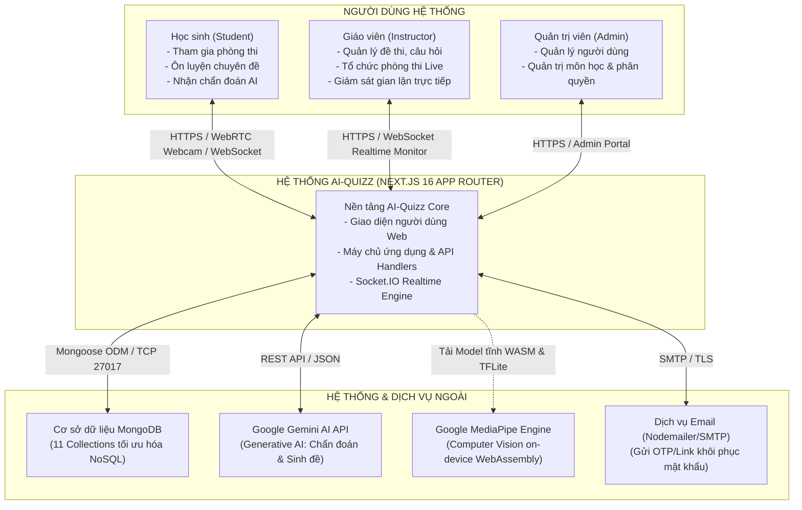
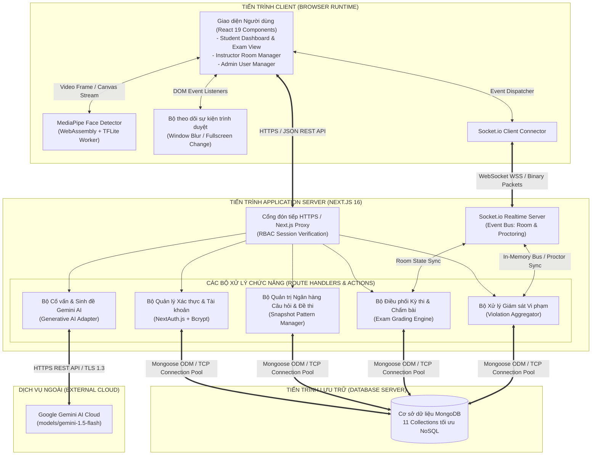
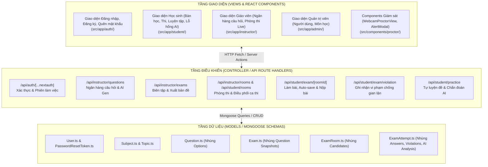
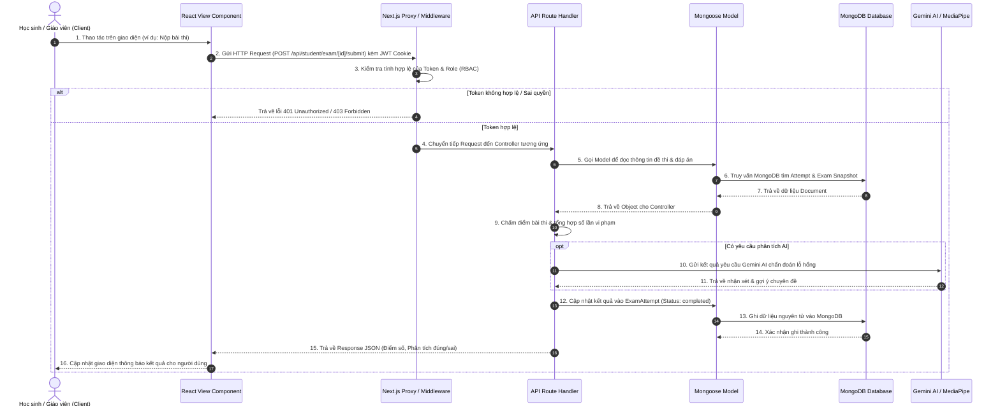

# BỘ GIÁO DỤC VÀ ĐÀO TẠO
# TRƯỜNG ĐẠI HỌC DUY TÂN
### KHOA CÔNG NGHỆ THÔNG TIN

---

<br/>

## TÊN ĐỀ TÀI:
# HỆ THỐNG KHẢO THÍ & ÔN LUYỆN TRẮC NGHIỆM TRỰC TUYẾN TÍCH HỢP TRÍ TUỆ NHÂN TẠO (AI-QUIZZ)

## TÀI LIỆU KIẾN TRÚC HỆ THỐNG
### (SOFTWARE ARCHITECTURE DOCUMENT)

<br/>

**Giảng viên hướng dẫn:** ThS. Đặng Ngọc Công  
**Nhóm sinh viên thực hiện:** Nhóm 17 – Khóa luận Tốt nghiệp 2026  
- Nguyễn Hoàng Nhân  
- (Các thành viên nhóm 17)  

**Đà Nẵng, Năm 2026**

---

## THÔNG TIN DỰ ÁN

| Thuộc tính | Chi tiết |
| :--- | :--- |
| **Tên dự án** | Hệ thống Khảo thí & Ôn luyện Trắc nghiệm Trực tuyến Tích hợp Trí tuệ Nhân tạo (AI-Quizz) |
| **Dự án viết tắt** | AI-Quizz (Nhom17) |
| **Ngày bắt đầu** | 01/01/2026 |
| **Ngày kết thúc** | 20/05/2026 |
| **Nơi thực hiện** | Khoa Công nghệ Thông tin – Trường Đại học Duy Tân |
| **Giảng viên hướng dẫn** | ThS. Đặng Ngọc Công |
| **Chủ sở hữu sản phẩm (PO)** | Nhóm phát triển Khóa luận Tốt nghiệp Nhóm 17 |
| **Quản lý dự án (PM)** | Nguyễn Hoàng Nhân |
| **Thành viên trong đội** | Sinh viên ngành Kỹ thuật Phần mềm / Công nghệ Thông tin |

---

## THÔNG TIN TÀI LIỆU

| Thuộc tính | Chi tiết |
| :--- | :--- |
| **Tên dự án** | AI-Quizz – Hệ thống Khảo thí & Ôn luyện Trắc nghiệm THPT Tích hợp AI |
| **Tiêu đề tài liệu** | Software Architecture Document (SAD) |
| **Người thực hiện** | Nhóm 17 |
| **Trạng thái** | Hoàn thành |

---

## LỊCH SỬ CHỈNH SỬA TÀI LIỆU

| Phiên bản | Người chỉnh sửa | Ngày | Ghi chú thay đổi |
| :---: | :--- | :---: | :--- |
| **1.0** | Nhóm 17 | 15/01/2026 | Khởi tạo tài liệu kiến trúc sơ bộ, bối cảnh và mục tiêu dự án |
| **1.1** | Nhóm 17 | 28/02/2026 | Cập nhật Product Backlog, phân hệ cơ sở dữ liệu MongoDB tối ưu 11 Models |
| **1.2** | Nhóm 17 | 10/04/2026 | Bổ sung C&C View, Module View theo kiến trúc Next.js 16 App Router |
| **2.0** | Nhóm 17 | 25/11/2026 | Tích hợp hoàn thiện Allocation View, Phân hệ PB12 AI Proctoring (MediaPipe WASM on-device) & Google Gemini AI Diagnostic |

---

## PHÊ DUYỆT TÀI LIỆU

| Vai trò | Họ và tên | Chữ ký | Ngày phê duyệt |
| :--- | :--- | :---: | :---: |
| **Giảng viên hướng dẫn** | ThS. Đặng Ngọc Công | *(Đã ký)* | …./…./2026 |
| **Chủ nhiệm đề tài / PO** | Nhóm trưởng Nhóm 17 | *(Đã ký)* | …./…./2026 |
| **Quản lý dự án (PM)** | Nguyễn Hoàng Nhân | *(Đã ký)* | …./…./2026 |

---

# MỤC LỤC

- [1. GIỚI THIỆU](#1-giới-thiệu)
  - [1.1. Mục đích tài liệu](#11-mục-đích-tài-liệu)
  - [1.2. Tài liệu liên quan](#12-tài-liệu-liên-quan)
  - [1.3. Đối tượng sử dụng tài liệu](#13-đối-tượng-sử-dụng-tài-liệu)
- [2. TỔNG QUAN](#2-tổng-quan)
  - [2.1. Tổng quan dự án](#21-tổng-quan-dự-án)
  - [2.2. Bối cảnh dự án](#22-bối-cảnh-dự-án)
  - [2.3. Mục tiêu dự kiến](#23-mục-tiêu-dự-kiến)
  - [2.4. Sơ đồ ngữ cảnh hệ thống (Context Diagram)](#24-sơ-đồ-ngữ-cảnh-hệ-thống-context-diagram)
- [3. CÁC YẾU TỐ TÁC ĐỘNG ĐẾN CẤU TRÚC](#3-các-yếu-tố-tác-động-đến-cấu-trúc)
  - [3.1. Yêu cầu về chức năng (Product Backlog)](#31-yêu-cầu-về-chức-năng-product-backlog)
  - [3.2. Các hạn chế về kinh doanh (Business Constraints)](#32-các-hạn-chế-về-kinh-doanh-business-constraints)
  - [3.3. Các hạn chế về kỹ thuật (Technical Constraints)](#33-các-hạn-chế-về-kỹ-thuật-technical-constraints)
  - [3.4. Các thuộc tính chất lượng (Quality Attributes - QARs)](#34-các-thuộc-tính-chất-lượng-quality-attributes---qars)
- [4. TỔNG QUAN VỀ CẤU TRÚC (C&C VIEW)](#4-tổng-quan-về-cấu-trúc-cc-view)
  - [4.1. Khái quát về Component-and-Connector View](#41-khái-quát-về-component-and-connector-view)
  - [4.2. Sơ đồ C&C View](#42-sơ-đồ-cc-view)
  - [4.3. Mô tả các thành phần và cổng kết nối](#43-mô-tả-các-thành-phần-và-cổng-kết-nối)
- [5. MODULE VIEW](#5-module-view)
  - [5.1. High-Level Module View](#51-high-level-module-view)
  - [5.2. Sơ đồ cấu trúc Module Next.js App Router](#52-sơ-đồ-cấu-trúc-module-nextjs-app-router)
  - [5.3. Mô tả chi tiết luồng xử lý yêu cầu (Request Flow)](#53-mô-tả-chi-tiết-luồng-xử-lý-yêu-cầu-request-flow)
- [6. ALLOCATION VIEW (DEPLOYMENT VIEW)](#6-allocation-view-deployment-view)
  - [6.1. Mô tả tổng quát môi trường triển khai](#61-mô-tả-tổng-quát-môi-trường-triển-khai)
  - [6.2. Sơ đồ phân bổ triển khai tổng thể](#62-sơ-đồ-phân-bổ-triển-khai-tổng-thể)
  - [6.3. Mô tả chi tiết các Node vật lý & logic](#63-mô-tả-chi-tiết-các-node-vật-lý--logic)

---

# 1. GIỚI THIỆU

### 1.1. Mục đích tài liệu
Tài liệu Kiến trúc Phần mềm (Software Architecture Document - SAD) mô tả toàn diện về cấu trúc, thiết kế kỹ thuật ở mức High-Level của hệ thống **AI-Quizz**. Tài liệu xác định:
- Các thành phần cốt lõi của hệ thống (Components), các mối liên kết (Connectors) và cơ chế truyền thông (Communication Protocols).
- Kiến trúc xử lý đa tầng: Mô hình Next.js App Router (kết hợp Server Components, Client Components, Server Actions và API Route Handlers), cơ sở dữ liệu phi quan hệ MongoDB hướng tài liệu, tầng thời gian thực Socket.io và cụm AI Hybrid (Edge AI on-device + Cloud Generative AI).
- Đảm bảo hệ thống thỏa mãn cả yêu cầu chức năng (Functional Requirements) và các thuộc tính chất lượng (Quality Attributes) như: tính khả dụng, độ bảo mật, khả năng mở rộng và hiệu năng phản hồi thời gian thực.

### 1.2. Tài liệu liên quan
1. Báo cáo đề xuất dự án (Project Proposal - AI-Quizz).
2. Kế hoạch quản lý dự án (Project Management Plan).
3. Danh mục tồn đọng sản phẩm (Product Backlog & User Stories).
4. Tài liệu đặc tả kiến trúc cơ sở dữ liệu MongoDB 11 Models ([`docs/KIEN_TRUC_CSDL_MONGODB.md`](file:///d:/Trắc_nghiệmAI/Nhom17/docs/KIEN_TRUC_CSDL_MONGODB.md)).
5. Đặc tả phân hệ Giám sát chống gian lận AI Proctoring ([`docs/PB12_Giam_Sat_Chong_Gian_Lan.md`](file:///d:/Trắc_nghiệmAI/Nhom17/docs/PB12_Giam_Sat_Chong_Gian_Lan.md)).
6. Hướng dẫn phân quyền kiểm soát truy cập theo vai trò RBAC ([`docs/HUONG_DAN_PHAN_QUYEN_RBAC.md`](file:///d:/Trắc_nghiệmAI/Nhom17/docs/HUONG_DAN_PHAN_QUYEN_RBAC.md)).

### 1.3. Đối tượng sử dụng tài liệu
- **Giảng viên hướng dẫn & Hội đồng phản biện:** Đánh giá tính chuẩn mực, tính hiện đại và tính khả thi trong giải pháp kiến trúc phần mềm của đồ án.
- **Nhà phát triển (Developers):** Nắm bắt ranh giới các module, chuẩn giao tiếp API, cấu trúc model dữ liệu và luồng sự kiện để mở rộng tính năng đồng bộ.
- **Nhà kiểm thử (Testers / QA):** Xây dựng các kịch bản kiểm thử tích hợp (Integration Tests), kiểm thử chịu tải (Load Tests) và kiểm thử an toàn bảo mật.

---

# 2. TỔNG QUAN

### 2.1. Tổng quan dự án
**AI-Quizz** là nền tảng khảo thí và ôn luyện thi trắc nghiệm trực tuyến thế hệ mới dành cho học sinh THPT và các cơ sở giáo dục, tích hợp trí tuệ nhân tạo (AI) toàn diện trong chu trình dạy - học - thi:
- **Khảo thí trực tuyến thời gian thực (Live Exam Room):** Cho phép giáo viên tổ chức các ca thi có bấm giờ đồng bộ, cấp mã PIN vào phòng, theo dõi trạng thái làm bài và chấm điểm tự động tức thì.
- **Giám sát chống gian lận thông minh (AI Proctoring):** Ứng dụng Computer Vision (Google MediaPipe WebAssembly) chạy trực tiếp tại trình duyệt thí sinh để phát hiện quay cóp, rời ghế, xuất hiện người lạ và kiểm soát hành vi chuyển tab/thoát toàn màn hình mà không cần gửi luồng video thô lên máy chủ.
- **Cố vấn học tập AI (Gemini AI Diagnostic):** Tự động phân tích điểm số, chẩn đoán chính xác lỗ hổng kiến thức theo chuyên đề và kiến tạo bài tập luyện bù cá nhân hóa.
- **Trợ lý biên soạn đề AI:** Hỗ trợ giáo viên trích xuất câu hỏi chuẩn ma trận kiến thức Bộ GD&ĐT từ tài liệu và tự động sinh lời giải chi tiết.

### 2.2. Bối cảnh dự án
Trước xu hướng chuyển đổi số mạnh mẽ trong giáo dục và sự thay đổi cấu trúc kỳ thi Tốt nghiệp THPT của Bộ GD&ĐT, các hệ thống thi trắc nghiệm truyền thống bộc lộ nhiều điểm hạn chế:
- Khó kiểm soát tính minh bạch khi thi trực tuyến từ xa, tình trạng mở tab tìm kiếm tài liệu hoặc thi hộ diễn ra tràn lan.
- Sau khi thi xong, học sinh chỉ nhận được điểm số đơn thuần mà không biết chính xác mình đang bị hổng ở dạng bài nào để cải thiện.
- Giáo viên tốn nhiều thời gian số hóa ngân hàng câu hỏi và chấm thi thủ công.

AI-Quizz ra đời nhằm giải quyết triệt để các vấn đề trên bằng cách kết hợp sức mạnh của **Edge AI (Computer Vision trên thiết bị)** và **Cloud LLM (Google Gemini)** trong một nền tảng thống nhất, mượt mà và bảo mật cao.

### 2.3. Mục tiêu dự kiến
1. **Phía Học sinh (Student):**
   - Đăng nhập/đăng ký, quản lý lộ trình học tập mục tiêu (điểm xét tuyển đại học khối A/B/D).
   - Tham gia phòng thi trực tuyến có bấm giờ, tự động lưu bài làm và tự động nộp bài khi hết giờ.
   - Trải nghiệm môi trường thi nghiêm túc với AI hỗ trợ nhắc nhở vi phạm trực tiếp.
   - Nhận báo cáo phân tích năng lực chi tiết và lộ trình bù đắp lỗ hổng kiến thức từ Gemini AI.
2. **Phía Giáo viên (Instructor):**
   - Quản lý danh mục môn học, xây dựng cây chuyên đề phân cấp cha - con.
   - Quản trị ngân hàng câu hỏi trắc nghiệm (phân loại 4 mức nhận thức, nhập tự động từ Word/Excel, sinh tự động từ AI).
   - Biên tập đề thi theo cơ chế Snapshot Pattern (bảo lưu nguyên vẹn đề thi lịch sử).
   - Mở và quản lý phòng thi Live: Theo dõi trạng thái vào phòng, tiến độ làm bài, nhận cảnh báo gian lận kèm ảnh bằng chứng realtime và xuất báo cáo phổ điểm.
3. **Phía Quản trị viên (Admin):**
   - Quản lý toàn bộ tài khoản người dùng, phân quyền RBAC (`student`, `instructor`, `admin`), khóa/mở tài khoản, giám sát hoạt động hệ thống.

### 2.4. Sơ đồ ngữ cảnh hệ thống (Context Diagram)



---

# 3. CÁC YẾU TỐ TÁC ĐỘNG ĐẾN CẤU TRÚC

### 3.1. Yêu cầu về chức năng (Product Backlog)

| ID Backlog | Tên Product Backlog | Phân hệ | Tác nhân | Mô tả tóm tắt |
| :---: | :--- | :---: | :---: | :--- |
| **PB01** | Đăng nhập & Xác thực | Phân hệ 1 | Tất cả | Xác thực tài khoản bằng Email/Mật khẩu (bcrypt salt 12) hoặc OAuth Google, cấp JWT session qua NextAuth.js. |
| **PB02** | Đăng ký tài khoản | Phân hệ 1 | Khách | Đăng ký thành viên mới, phân quyền mặc định là `student`, kích hoạt tức thì. |
| **PB03** | Quên & Đặt lại mật khẩu | Phân hệ 1 | Tất cả | Gửi mã OTP/Token qua email, token lưu trong collection riêng với cơ chế TTL Index tự hủy sau 20 phút. |
| **PB04** | Quản lý thông tin cá nhân | Phân hệ 1 | Tất cả | Cập nhật họ tên, ảnh đại diện, số điện thoại, đổi mật khẩu và xem thống kê học tập cá nhân. |
| **PB05** | Quản lý Môn học & Cây chủ đề | Phân hệ 2 | GV, Admin | Quản lý danh mục môn học THPT, dựng cấu trúc cây chuyên đề/chủ đề đa cấp qua khóa ngoại tự liên kết `parent_id`. |
| **PB06** | Quản lý Ngân hàng câu hỏi | Phân hệ 2 | GV, Admin | CRUD câu hỏi 4 mức độ nhận thức (Nhận biết, Thông hiểu, Vận dụng, Vận dụng cao), nhúng mảng `options: [A, B, C, D]`, nhập từ Word/Excel, phân trang 10/20/50 câu. |
| **PB07** | Trợ lý soạn đề & Sinh câu hỏi AI | Phân hệ 2 | Giáo viên | Kết nối Google Gemini AI để tự động tạo câu hỏi trắc nghiệm theo chuyên đề, trích xuất ma trận và tạo lời giải chi tiết. |
| **PB08** | Quản lý & Xuất bản Đề thi | Phân hệ 3 | Giáo viên | Tạo đề thi từ ngân hàng (chọn thủ công hoặc bốc ngẫu nhiên theo ma trận), áp dụng **Snapshot Pattern** bảo lưu vĩnh viễn câu hỏi trong đề. |
| **PB09** | Tổ chức Phòng thi Live (Socket.io) | Phân hệ 3 | Giáo viên | Mở ca thi trực tuyến, cấp mã PIN phòng, theo dõi danh sách thí sinh kết nối, trạng thái làm bài và nộp bài realtime. Xóa phòng thi chờ/kết thúc an toàn. |
| **PB10** | Làm bài thi trực tuyến & Bấm giờ | Phân hệ 4 | Học sinh | Nhập PIN vào phòng, đồng hồ đếm ngược đồng bộ server, lưu câu trả lời tự động (Auto-save), tự động thu bài khi hết giờ. |
| **PB11** | Tự luyện đề & Lịch sử làm bài | Phân hệ 4 | Học sinh | Tự luyện thi theo môn/chủ đề, xem lại lịch sử các lượt thi, phân tích đáp án đúng/sai và phương pháp giải chi tiết. |
| **PB12** | Giám sát chống gian lận AI (AI Proctoring) | Phân hệ 4 | HS, GV | Phát hiện chuyển tab/thoát Fullscreen; AI MediaPipe phát hiện rời ghế, phát hiện nhiều người, quay cóp nhìn lệch; chụp ảnh bằng chứng, gửi realtime về giáo viên. |
| **PB13** | Chẩn đoán lỗ hổng kiến thức AI | Phân hệ 4 | Học sinh | Gemini AI chẩn đoán điểm yếu sau các bài thi, hiển thị modal danh sách chuyên đề cần củng cố và nút luyện bù ngay lập tức. |
| **PB14** | Báo cáo, Phổ điểm & Thống kê | Phân hệ 4 | GV, Admin | Trực quan hóa phổ điểm, tỷ lệ đúng/sai theo từng câu hỏi, thống kê lượt nộp bài, tỷ lệ vi phạm phòng thi. |
| **PB15** | Quản lý người dùng & RBAC | Phân hệ 1 | Admin | Xem danh sách người dùng, tìm kiếm, lọc theo vai trò, thay đổi quyền hạn (`student`, `instructor`, `admin`), khóa/mở tài khoản. |

### 3.2. Các hạn chế về kinh doanh (Business Constraints)
1. **Thời hạn thực hiện:** Dự án triển khai từ tháng 01/2026 đến tháng 05/2026 phục vụ bảo vệ Khóa luận Tốt nghiệp tại Đại học Duy Tân. Sau khi nghiệm thu, nhóm tập trung tối ưu hóa và bảo trì.
2. **Ngân sách phần mềm:** Dự án không có ngân sách thương mại mua bản quyền phần mềm độc quyền. Toàn bộ công nghệ được sử dụng phải là mã nguồn mở (Open Source) hoặc các gói dịch vụ AI có hạn mức miễn phí (Free Tier) phù hợp cho giáo dục.
3. **Chi phí tính toán AI:** Giải pháp giám sát camera không được làm phát sinh chi phí Cloud GPU đắt đỏ; do đó mô hình phát hiện khuôn mặt phải chạy hoàn toàn trên phần cứng Client của học sinh.

### 3.3. Các hạn chế về kỹ thuật (Technical Constraints)
1. **Kiến trúc Nền tảng:** Sử dụng **Next.js 16 (App Router)** chạy trên Node.js runtime, ngôn ngữ **TypeScript** 100%, trình quản lý gói `npm`, công cụ biên dịch Turbopack.
2. **Cơ sở dữ liệu:** Sử dụng **MongoDB (NoSQL)** kết hợp **Mongoose 9 ODM**, áp dụng kỹ thuật nhúng tài liệu con (Document Embedding) để triệt tiêu chi phí `$lookup` (JOIN) trên các bảng phụ thuộc.
3. **Giao tiếp Realtime:** Sử dụng giao thức **WebSocket thông qua thư viện Socket.io** để đồng bộ trạng thái phòng thi và phát sự kiện vi phạm gian lận trực tiếp giữa Học sinh và Giáo viên.
4. **Mô hình Trí tuệ Nhân tạo:**
   - *Phát hiện gian lận webcam:* Google MediaPipe Face Detection (phiên bản WebAssembly SIMD + mô hình TensorFlow Lite `short_range` ~229KB), self-hosted cục bộ tại `public/mediapipe/`.
   - *Sinh đề & Chẩn đoán tri thức:* Google Gemini API (`@google/generative-ai` SDK).
5. **Môi trường người dùng:** Học sinh và giáo viên sử dụng trình duyệt chuẩn hiện đại (Google Chrome, Microsoft Edge, Mozilla Firefox) hỗ trợ WebAssembly, WebRTC getUserMedia và Fullscreen API trên máy tính Windows, macOS hoặc Linux.

### 3.4. Các thuộc tính chất lượng (Quality Attributes - QARs)

| Mã QAR | Thuộc tính chất lượng | Kịch bản kiến trúc | Mức quan trọng | Độ phức tạp | Giải pháp kiến trúc đáp ứng |
| :---: | :--- | :--- | :---: | :---: | :--- |
| **QAR-01** | **Performance (Hiệu năng)** | Khi thí sinh nộp bài thi gồm 50 câu, hệ thống phải chấm điểm và lưu kết quả dưới 500ms. | **High (H)** | **Medium (M)** | Nhúng trực tiếp mảng câu hỏi và đáp án vào Document `ExamAttempt`; chấm bài hoàn toàn trong bộ nhớ RAM server trước khi ghi 1 lần duy nhất vào MongoDB. |
| **QAR-02** | **Zero-Cloud-Cost Proctoring** | Khi 50 thí sinh cùng mở camera trong phòng thi, server không được quá tải CPU hay cạn băng thông mạng. | **High (H)** | **High (H)** | Kiến trúc Edge AI: Chạy MediaPipe trực tiếp trên trình duyệt thí sinh bằng WebAssembly. Máy chủ chỉ truyền tải tin nhắn Socket.io (JSON) và ảnh chụp snapshot khi có vi phạm. |
| **QAR-03** | **Data Integrity (Liêm chính dữ liệu)** | Ngân hàng câu hỏi bị giáo viên chỉnh sửa hoặc xóa thì các đề thi và bài thi đã làm trong quá khứ không bị thay đổi nội dung. | **High (H)** | **Low (L)** | Áp dụng **Snapshot Pattern**: Khi xuất bản đề thi (`Exam`), toàn bộ nội dung câu hỏi và đáp án được copy cố định vào đề thi, độc lập hoàn toàn với ngân hàng câu hỏi gốc. |
| **QAR-04** | **Security & Access Control** | Người dùng không thể truy cập trái phép vào các trang quản trị hoặc xem trước đáp án khi đang làm bài. | **High (H)** | **Medium (M)** | Kiểm soát đa tầng: Next.js Proxy/Middleware xác thực vai trò RBAC; API route ẩn trường `is_correct` của các đáp án khi học sinh đang trong trạng thái làm bài thi. |
| **QAR-05** | **Scalability & Concurrency** | Khi toàn bộ thí sinh cùng nộp bài ở giây cuối cùng của ca thi, hệ thống không bị nghẽn (Race Condition). | **High (H)** | **High (H)** | MongoDB Atomic Updates (`findOneAndUpdate`, `$set`), cơ chế idempotency bảo đảm chỉ chấm 1 lần duy nhất cho mỗi `attempt_id`. |
| **QAR-06** | **Availability & Offline Resilience** | Đường truyền internet quốc tế bị chập chờn thì AI nhận diện khuôn mặt của học sinh vẫn tiếp tục chạy. | **Medium (M)** | **Low (L)** | Toàn bộ tệp `.wasm`, `.tflite` được lưu trữ nội bộ tại thư mục `public/` (Self-hosted), không gọi bất kỳ request nào ra CDN quốc tế. |

---

# 4. TỔNG QUAN VỀ CẤU TRÚC (C&C VIEW)

### 4.1. Khái quát về Component-and-Connector View
Mô hình Thành phần và Kết nối (Component-and-Connector - C&C View) mô tả các thực thể đang hoạt động trong thời gian chạy (Runtime) của hệ thống AI-Quizz: các tiến trình client, các bộ xử lý server, kho lưu trữ dữ liệu và các kênh truyền thông liên kết giữa chúng.

### 4.2. Sơ đồ C&C View



### 4.3. Mô tả các thành phần và cổng kết nối
1. **Các thành phần (Components):**
   - **Client UI:** Ứng dụng Single Page / Server Rendered chạy trên trình duyệt người dùng, quản lý giao diện thi, giao diện soạn đề và bảng điều khiển.
   - **MediaPipe WASM Engine:** Thực thi mô hình mạng nơ-ron nhận diện khuôn mặt trực tiếp trong Client runtime với tần suất 450ms/lần kiểm tra.
   - **HTTPS Gateway & RBAC Proxy:** Điểm tiếp nhận trung tâm của toàn bộ request từ Client, kiểm tra tính hợp lệ của Cookie JWT trước khi phân luồng vào các bộ xử lý chuyên biệt.
   - **Exam Grading Engine:** Tiếp nhận bài làm của học sinh, so khớp đáp án nguyên tử và tính toán điểm số chính xác dựa trên công thức quy đổi thang điểm 10.
   - **Violation Aggregator & Proctor Live Bus:** Tiếp nhận cảnh báo gian lận từ client, ghi nhật ký vào `ExamAttempt.violations` và phát tán ngay lập tức lên SocketServer.
   - **SocketServer (Event Bus):** Giữ kết nối song công (Duplex WebSocket) với hàng trăm client, quản lý các Room theo `roomId` để phát tin nhắn riêng cho từng phòng thi.
   - **MongoDB Server:** Lưu trữ dữ liệu lâu dài với 11 collections đã được thiết kế embedding tối ưu.
2. **Các cổng kết nối (Connectors):**
   - **HTTPS REST / JSON Connector:** Đồng bộ dữ liệu CRUD, gọi API nộp bài, lưu đáp án tạm.
   - **WebSocket Connector:** Giao tiếp hai chiều tốc độ cao phục vụ đếm ngược phòng thi và đẩy cảnh báo vi phạm.
   - **Mongoose / MongoDB Wire Protocol:** Kết nối TCP có Connection Pooling tối ưu kết nối đến cơ sở dữ liệu.
   - **Google Generative AI SDK Connector:** Giao tiếp bảo mật bằng API Key với máy chủ AI của Google.

---

# 5. MODULE VIEW

### 5.1. High-Level Module View
AI-Quizz được xây dựng dựa trên kiến trúc **Next.js 16 App Router hiện đại**, tổ chức mã nguồn theo mô hình mở rộng của **Model - View - Controller (MVC)** kết hợp **Server Actions** và **Component-Driven UI**:
- **Models (`src/models/`):** Định nghĩa cấu trúc Schema và tương tác dữ liệu thông qua Mongoose ODM.
- **Controllers / Handlers (`src/app/api/`):** Các Route Handlers tiếp nhận HTTP Request, xác thực nghiệp vụ, gọi Model và trả về JSON chuẩn.
- **Views (`src/app/` & `src/components/`):** Gồm Server Components (kết xuất tĩnh/động tại server để tăng tốc SEO và tải trang) và Client Components (quản lý trạng thái tương tác phong phú, camera, socket).
- **Hooks & Libs (`src/hooks/`, `src/lib/`):** Tách biệt logic nghiệp vụ tái sử dụng (giám sát camera, phát hiện chuyển tab, kết nối database).

### 5.2. Sơ đồ cấu trúc Module Next.js App Router



### 5.3. Mô tả chi tiết luồng xử lý yêu cầu (Request Flow)



| Bước | Thành phần | Mô tả chi tiết hoạt động |
| :---: | :--- | :--- |
| **1 - 2** | Client ➔ Proxy | Người dùng thực hiện thao tác (nộp bài, đổi bộ lọc, tạo đề thi...). Giao diện đóng gói dữ liệu và gửi yêu cầu HTTPS đến máy chủ. |
| **3** | Next.js Proxy | Kiểm tra phiên làm việc (Session) qua NextAuth. Nếu người dùng chưa đăng nhập hoặc không đúng quyền (ví dụ học sinh cố vào trang giáo viên), yêu cầu bị chặn lại ngay lập tức. |
| **4** | Proxy ➔ Controller | Chuyển tiếp yêu cầu hợp lệ vào API Route Handler tương ứng để xử lý logic nghiệp vụ. |
| **5 - 8** | Controller ➔ Model ➔ DB | Controller tương tác với các Model Mongoose để đọc dữ liệu cần thiết từ cơ sở dữ liệu MongoDB. |
| **9** | Controller Logic | Thực thi thuật toán nghiệp vụ (ví dụ: so khớp các lựa chọn của học sinh với đáp án đúng trong Snapshot đề thi, tính điểm, thống kê thời gian làm bài). |
| **10 - 11** | External AI Call | (Nếu áp dụng) Controller gọi Google Gemini API để phân tích phổ kiến thức hoặc tạo câu hỏi mới. |
| **12 - 14**| Model ➔ DB Update | Controller thực hiện cập nhật trạng thái mới xuống cơ sở dữ liệu bằng các toán tử cập nhật nguyên tử (`$set`, `$push`). |
| **15 - 16**| Controller ➔ View ➔ User | Controller đóng gói kết quả dưới dạng JSON chuẩn `{ success: true, data: ... }` gửi về client để React Render lại giao diện cho người dùng xem. |

---

# 6. ALLOCATION VIEW (DEPLOYMENT VIEW)

### 6.1. Mô tả tổng quát môi trường triển khai
Mô hình Phân bổ Triển khai (Allocation View / Deployment View) thể hiện cách thức các thành phần phần mềm của AI-Quizz được gán vào các nút phần cứng (Hardware Nodes), mạng truyền thông (Networks) và các dịch vụ đám mây (Cloud Services) trong môi trường vận hành thực tế.

Hệ thống được thiết kế theo mô hình **Phân tán lai (Hybrid Distributed Deployment)**:
- **Client Nodes:** Các máy tính của học sinh và giáo viên, đảm nhận việc render giao diện và tính toán AI Computer Vision tại chỗ.
- **Application Server Node:** Máy chủ ứng dụng chạy môi trường Node.js điều khiển Next.js 16 và máy chủ thời gian thực Socket.io.
- **Database Server Node:** Cụm máy chủ lưu trữ cơ sở dữ liệu MongoDB đảm bảo tính toàn vẹn và chịu tải cao.
- **External AI Cloud:** Đám mây Google Cloud AI phục vụ các tác vụ Mô hình Ngôn ngữ Lớn (LLM).

### 6.2. Sơ đồ phân bổ triển khai tổng thể

```mermaid
deploymentDiagram
    subgraph ClientDevice1["THIẾT BỊ HỌC SINH (CLIENT PC / LAPTOP)"]
        node Browser1["Web Browser (Chrome / Edge / Firefox)"] {
            artifact ReactApp1["Next.js Client Application"]
            artifact MediaPipeWasm["MediaPipe WASM Engine (Self-hosted)"]
            artifact HardwareCam["Webcam Driver Interface"]
        }
    end

    subgraph ClientDevice2["THIẾT BỊ GIÁO VIÊN / ADMIN (CLIENT PC)"]
        node Browser2["Web Browser (Chrome / Edge / Firefox)"] {
            artifact ReactApp2["Next.js Instructor / Admin Dashboard"]
            artifact SocketMonitor["Live Room Monitoring Canvas"]
        }
    end

    subgraph AppServer["APPLICATION SERVER (NODE.JS / NEXT.JS HOST)"]
        node NextJsNode["Next.js 16 Application Runtime"] {
            artifact SSR_Engine["Server-Side Rendering & Turbopack"]
            artifact RouteHandlers["API Route Handlers (Edge & Node Runtime)"]
            artifact AuthModule["NextAuth Security Engine"]
        }
        node RealtimeNode["Socket.io Server Process"] {
            artifact RoomManager["Room State & Timer Synchronizer"]
            artifact ProctorBus["Proctor Live Event Dispatcher"]
        }
    end

    subgraph DBServer["DATABASE SERVER (MONGODB INSTANCE)"]
        database MongoDBNode["MongoDB Database Engine (v6.0+)"] {
            artifact CollUser["users / password_reset_tokens"]
            artifact CollBank["subjects / topics / questions"]
            artifact CollExam["exams / exam_rooms"]
            artifact CollAttempt["exam_attempts (Embedded Details)"]
        }
    end

    subgraph CloudServices["EXTERNAL CLOUD SERVICES"]
        cloud GoogleCloud["Google Cloud Platform"] {
            artifact GeminiAPI["Gemini 1.5 Flash Generative AI Service"]
        }
        cloud SMTPServer["Mail Delivery Service"] {
            artifact MailService["SMTP Relay (Gmail / SendGrid)"]
        }
    end

    %% Network Connections
    Browser1 <==>|HTTPS / TLS 1.3 (Port 443)| NextJsNode
    Browser1 <==>|WebSocket WSS (Port 3000/3001)| RealtimeNode
    Browser2 <==>|HTTPS / TLS 1.3 (Port 443)| NextJsNode
    Browser2 <==>|WebSocket WSS (Port 3000/3001)| RealtimeNode

    NextJsNode <==>|TCP Connection Pool (Port 27017)| MongoDBNode
    RealtimeNode <==>|In-Memory Bridge| NextJsNode

    NextJsNode <==>|HTTPS REST API (Outbound)| GeminiAPI
    NextJsNode <==>|SMTP TLS (Port 587/465)| MailService
```

### 6.3. Mô tả chi tiết các Node vật lý & logic

| Node Triển Khai | Loại tài nguyên | Công nghệ phần mềm | Trách nhiệm và vai trò trong hệ thống |
| :--- | :--- | :--- | :--- |
| **Client Devices (Học sinh & Giáo viên)** | Máy tính cá nhân (Windows, macOS, Linux) | Trình duyệt Web (Chrome, Edge, Firefox), WebAssembly, WebRTC | - Hiển thị giao diện người dùng.<br>- Truy cập Webcam máy tính, thực thi mô hình nhận diện khuôn mặt MediaPipe on-device.<br>- Lắng nghe và kích hoạt sự kiện vi phạm gian lận trực tiếp.<br>- Thiết lập kết nối song công WSS với Socket Server. |
| **Application Server Node** | Máy chủ vật lý hoặc Cloud VPS (Ubuntu Linux / Windows Server, Min 2 Cores CPU, 4GB RAM) | Node.js v20 LTS, Next.js 16, NextAuth, Socket.io | - Đóng vai trò máy chủ ứng dụng chính.<br>- Biên dịch Server Components, định tuyến URL và thực thi API Route Handlers.<br>- Kiểm soát xác thực phiên làm việc và bảo vệ đường dẫn theo vai trò RBAC.<br>- Duy trì Socket.io Server đồng bộ đếm ngược thời gian ca thi và chuyển tiếp cảnh báo vi phạm. |
| **Database Server Node** | Máy chủ Cơ sở dữ liệu (MongoDB Atlas hoặc MongoDB Server Local) | MongoDB Engine v6.0+, Mongoose 9 ODM | - Lưu trữ an toàn toàn bộ dữ liệu hệ thống (11 collections).<br>- Tối ưu hóa truy vấn thông qua các chỉ mục (Indexes: Compound Index, Unique Index, TTL Index).<br>- Thực hiện các thao tác đọc/ghi nguyên tử khi thí sinh nộp bài thi. |
| **Google Cloud AI Service** | Dịch vụ AI Đám mây (SaaS / API) | Google Generative AI (Gemini 1.5 Flash) | - Tiếp nhận yêu cầu phân tích phổ điểm và chẩn đoán lỗ hổng kiến thức.<br>- Tự động sinh câu hỏi trắc nghiệm và lời giải chi tiết theo yêu cầu của giáo viên. |
| **SMTP Mail Server** | Dịch vụ gửi thư điện tử (SaaS) | Giao thức SMTP (TLS/SSL) | - Tiếp nhận yêu cầu từ hệ thống và gửi email chứa mã OTP / Token khôi phục mật khẩu đến hòm thư người dùng. |

---

## 7. KẾT LUẬN

Tài liệu Kiến trúc Phần mềm trên đây đã chuẩn hóa toàn bộ cấu trúc kỹ thuật của hệ thống **AI-Quizz (Hệ thống Khảo thí & Ôn luyện Trắc nghiệm Trực tuyến Tích hợp AI)**. Việc phân rã kiến trúc thành 3 góc nhìn cốt lõi:
1. **C&C View:** Làm rõ cơ chế phân tán tải giữa Client WebAssembly và Server Socket.io.
2. **Module View:** Chuẩn hóa quy trình phát triển theo chuẩn Next.js 16 App Router và Mongoose ODM.
3. **Allocation View:** Bảo đảm tính khả thi trong việc triển khai thực tế trên hạ tầng đám mây với chi phí vận hành tối ưu nhất.

Kiến trúc này là cơ sở vững chắc để nhóm hoàn thiện các pha phát triển, kiểm thử và bảo vệ thành công Khóa luận Tốt nghiệp tại Trường Đại học Duy Tân.
